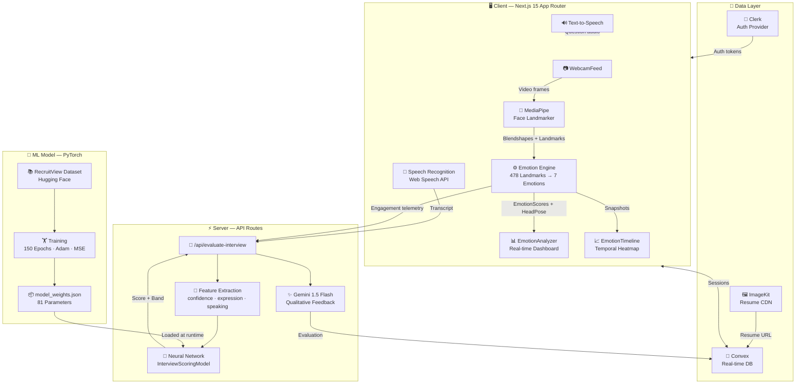
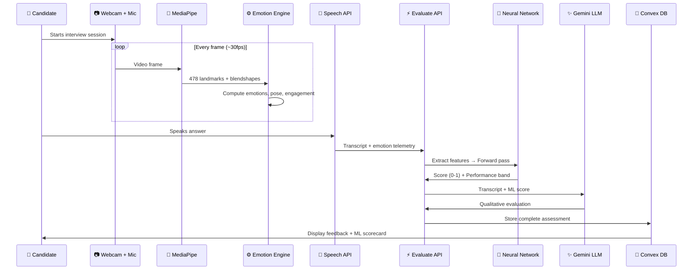

<div align="center">

# 🎯 RecruitSense-AI

### AI-Powered Mock Interview Platform with Real-Time Emotion Analysis & Neural Network Scoring

[](https://nextjs.org/)
[](https://react.dev/)
[](https://www.typescriptlang.org/)
[](https://tailwindcss.com/)
[](https://pytorch.org/)
[](https://ai.google.dev/edge/mediapipe/solutions/vision/face_landmarker)
[](LICENSE)

**RecruitSense-AI** is a full-stack AI mock interview platform that combines **real-time facial emotion analysis** (via Google MediaPipe), **speech recognition**, and a **custom-trained PyTorch neural network** to deliver objective, data-driven candidate assessments — simulating how next-generation recruitment AI systems evaluate soft skills beyond keyword matching.

[Features](#-features) · [Architecture](#-system-architecture) · [Model](#-custom-ml-model) · [Getting Started](#-getting-started) · [Tech Stack](#-tech-stack) · [Contributors](#-contributors)

</div>

---

## ✨ Features

### 🧠 Real-Time Emotion & Engagement Analysis
- **7-class emotion detection** (Happy, Neutral, Sad, Angry, Fear, Surprise, Disgust) from webcam feed using Google MediaPipe Face Landmarker with 478 facial landmarks
- **Head pose estimation** (pitch, yaw, roll) for posture and eye-contact tracking
- **Smile detection state machine** with debounced activation thresholds
- **Engagement scoring** — composite metric derived from eye contact retention, facial expressiveness, and head pose stability
- **Lighting quality assessment** — real-time feedback on ambient illumination conditions

### 🤖 Custom Neural Network Scoring
- **PyTorch MLP regressor** trained on the [`AI4A-lab/RecruitView`](https://huggingface.co/datasets/AI4A-lab/RecruitView) multimodal interview dataset
- Runs inference **directly in TypeScript** — zero external runtime, zero latency, fully serverless
- Produces a single holistic interview score from three behavioral features extracted during the live session
- Performance banding system (Excellent / Good / Average / Below Average)

### 🎤 Speech Intelligence
- **Real-time Speech-to-Text** via Web Speech API for hands-free candidate responses
- **Text-to-Speech** for AI interviewer question delivery
- Natural turn-taking conversational flow

### 📊 Post-Interview Analytics
- **ML Model Scorecard** — dark-gradient card displaying neural network output, raw score, performance band, and input feature breakdown
- **Emotion Timeline** — temporal emotion distribution across the interview session
- **Per-question AI evaluation** — Gemini 1.5 Flash powered qualitative feedback with technical depth scoring
- **Downloadable session analytics** with full engagement telemetry

### 🔐 Full-Stack Platform
- **Clerk authentication** — secure sign-in/sign-up with session management
- **Convex real-time database** — reactive data sync for interview sessions, user profiles, and evaluation results
- **Resume upload & parsing** via ImageKit CDN
- **Dynamic question generation** — AI-generated interview questions tailored to job description and resume context

---

## 🏗 System Architecture



---

## 🧮 Custom ML Model

### Architecture — `InterviewScoringModel`

A lightweight **Multi-Layer Perceptron (MLP) Regressor** designed for real-time inference within a serverless TypeScript environment.

```
Input Vector [x₁, x₂, x₃]        ← confidence_score, facial_expression, speaking_skills
         │
         ▼
  ┌──────────────┐
  │ Linear(3, 16)│                 ← 48 weights + 16 biases = 64 parameters
  └──────────────┘
         │
         ▼
      ReLU(·)                      ← Non-linear activation
         │
         ▼
  ┌──────────────┐
  │ Linear(16, 1)│                 ← 16 weights + 1 bias = 17 parameters
  └──────────────┘
         │
         ▼
  interview_score ∈ [0, 1]         ← Normalized candidate performance score

Total: 81 trainable parameters
```

### Training Configuration

| Parameter | Value |
| :--- | :--- |
| **Dataset** | [`AI4A-lab/RecruitView`](https://huggingface.co/datasets/AI4A-lab/RecruitView) (Hugging Face) |
| **Framework** | PyTorch 2.x (Google Colab GPU runtime) |
| **Optimizer** | Adam (lr = 0.01) |
| **Loss Function** | Mean Squared Error (MSE) |
| **Epochs** | 150 |
| **Train/Test Split** | 80/20 |
| **Test R² Score** | 0.6913 |

### Input Feature Pipeline

| Feature | Range | Live Signal Source |
| :--- | :--- | :--- |
| `confidence_score` | `0.0 – 1.0` | Eye-contact retention + head pose stability via MediaPipe Face Landmarker |
| `facial_expression` | `0.0 – 1.0` | Blendshape weights, smile state machine, positive affect telemetry |
| `speaking_skills` | `0.0 – 1.0` | Technical accuracy and depth of spoken responses |

### Inference in TypeScript

The model weights (`model_weights.json` — 81 parameters: $W_1, b_1, W_2, b_2$) are loaded directly into TypeScript, performing the exact forward pass without any Python runtime:

```typescript
// lib/interviewScoringModel.ts
const hidden = relu(matmul(W1, input) + b1);   // Linear(3,16) + ReLU
const output = matmul(W2, hidden) + b2;         // Linear(16,1)
return clamp(output, 0, 1);                      // Normalized score
```

### Model Artifacts

| File | Format | Purpose |
| :--- | :--- | :--- |
| `models/interview_scoring_model.pth` | PyTorch | Native checkpoint (`state_dict`) |
| `models/interview_scoring_model.onnx` | ONNX | Cross-platform deployment |
| `models/model_weights.json` | JSON | TypeScript inference (production) |

---

## 🛠 Tech Stack

<table>
  <tr>
    <td><b>Category</b></td>
    <td><b>Technology</b></td>
  </tr>
  <tr>
    <td>Framework</td>
    <td>Next.js 15 (App Router) + React 19</td>
  </tr>
  <tr>
    <td>Language</td>
    <td>TypeScript 5</td>
  </tr>
  <tr>
    <td>Styling</td>
    <td>Tailwind CSS v4 + Radix UI Primitives</td>
  </tr>
  <tr>
    <td>Animation</td>
    <td>Motion (Framer Motion)</td>
  </tr>
  <tr>
    <td>Authentication</td>
    <td>Clerk</td>
  </tr>
  <tr>
    <td>Database</td>
    <td>Convex (real-time, serverless)</td>
  </tr>
  <tr>
    <td>Computer Vision</td>
    <td>Google MediaPipe Face Landmarker (478 landmarks)</td>
  </tr>
  <tr>
    <td>ML Model</td>
    <td>PyTorch MLP → TypeScript inference engine</td>
  </tr>
  <tr>
    <td>ML Dataset</td>
    <td>AI4A-lab/RecruitView (Hugging Face)</td>
  </tr>
  <tr>
    <td>LLM</td>
    <td>Google Gemini 1.5 Flash (qualitative evaluation)</td>
  </tr>
  <tr>
    <td>Speech</td>
    <td>Web Speech API (STT + TTS)</td>
  </tr>
  <tr>
    <td>File Upload</td>
    <td>ImageKit CDN</td>
  </tr>
  <tr>
    <td>3D Globe</td>
    <td>COBE</td>
  </tr>
  <tr>
    <td>Icons</td>
    <td>Lucide React + Tabler Icons</td>
  </tr>
</table>

---

## 📂 Project Structure

```
RecruitSense-AI/
├── app/
│   ├── (routes)/
│   │   ├── _components/          # Shared route components (header, dialogs)
│   │   ├── dashboard/            # Dashboard pages + interview cards
│   │   └── interview/
│   │       └── [interviewId]/
│   │           ├── page.tsx      # Live interview session
│   │           └── feedback/
│   │               └── page.tsx  # Post-interview evaluation + ML scorecard
│   ├── api/
│   │   ├── evaluate-interview/
│   │   │   └── route.ts          # Neural network + Gemini evaluation endpoint
│   │   └── generate-interview-ques/
│   │       └── route.tsx         # AI question generation
│   ├── sign-in/                  # Clerk auth pages
│   ├── sign-up/
│   └── layout.tsx                # Root layout + providers
│
├── components/
│   ├── analytics/
│   │   ├── EmotionDashboard.tsx  # Aggregated emotion analytics
│   │   └── EmotionTimeline.tsx   # Temporal emotion heatmap
│   ├── interview/
│   │   ├── EmotionAnalyzer.tsx   # Real-time emotion HUD
│   │   └── WebcamFeed.tsx        # Camera stream + MediaPipe integration
│   └── ui/                      # Radix-based design system
│
├── hooks/
│   ├── useEmotionTracker.ts      # Emotion snapshot collector
│   ├── useMediaPipeFaceLandmarker.ts  # MediaPipe initialization + inference
│   ├── useSpeechRecognition.ts   # Web Speech API (STT)
│   ├── useSpeechSynthesis.ts     # Web Speech API (TTS)
│   └── useWebcam.ts              # Camera stream management
│
├── lib/
│   ├── emotionEngine.ts          # 478-landmark → 7-emotion processing
│   ├── interviewScoringModel.ts  # PyTorch model TypeScript inference engine
│   ├── model_weights.json        # Extracted neural network parameters
│   └── utils.ts                  # Shared utilities
│
├── models/
│   ├── interview_scoring_model.pth   # PyTorch checkpoint
│   ├── interview_scoring_model.onnx  # ONNX export
│   ├── model_weights.json            # Weights for TS inference
│   └── README.md                     # Model documentation
│
├── convex/
│   ├── schema.ts                 # Database schema (users + sessions)
│   ├── Interview.ts              # Session CRUD mutations
│   └── users.ts                  # User management
│
├── context/
│   └── UserDetailContext.tsx      # Global user state
│
└── middleware.ts                  # Clerk auth middleware
```

---

## 🚀 Getting Started

### Prerequisites

| Requirement | Version |
| :--- | :--- |
| Node.js | ≥ 18.x |
| npm | ≥ 9.x |
| Git | Latest |
| Webcam | Required for emotion analysis |
| Microphone | Required for speech recognition |

### 1. Clone the Repository

```bash
git clone https://github.com/cXOder6996/RecruitSense-AI.git
cd RecruitSense-AI
```

### 2. Install Dependencies

```bash
npm install --legacy-peer-deps
```

### 3. Configure Environment Variables

Create a `.env.local` file in the root directory:

```env
# Clerk Authentication
NEXT_PUBLIC_CLERK_PUBLISHABLE_KEY=pk_test_...
CLERK_SECRET_KEY=sk_test_...
NEXT_PUBLIC_CLERK_SIGN_IN_URL=/sign-in
NEXT_PUBLIC_CLERK_SIGN_UP_URL=/sign-up

# Convex Database
CONVEX_DEPLOYMENT=dev:your-deployment-slug
NEXT_PUBLIC_CONVEX_URL=https://your-deployment.convex.cloud

# Google Gemini (optional — falls back to local evaluator)
NEXT_PUBLIC_GEMINI_API_KEY=your_gemini_api_key

# ImageKit (resume uploads)
NEXT_PUBLIC_IMAGEKIT_PUBLIC_KEY=your_imagekit_public_key
IMAGEKIT_PRIVATE_KEY=your_imagekit_private_key
NEXT_PUBLIC_IMAGEKIT_URL_ENDPOINT=https://ik.imagekit.io/your_id

# n8n Webhooks (optional)
NEXT_PUBLIC_N8N_WEBHOOK_URL=your_webhook_url
```

### 4. Initialize Convex

```bash
npx convex dev
```

### 5. Start the Development Server

```bash
npm run dev
```

Open **[http://localhost:3000](http://localhost:3000)** — sign in, create an interview session, and experience the AI-powered evaluation.

---

## 🔬 How It Works



1. **Capture** — Webcam streams video frames to MediaPipe Face Landmarker at ~30fps
2. **Analyze** — The emotion engine extracts 7-class emotions, head pose, eye contact, and engagement from 478 facial landmarks
3. **Listen** — Web Speech API transcribes the candidate's spoken responses in real-time
4. **Score** — The custom neural network processes `[confidence, expression, speaking]` features through the trained MLP
5. **Evaluate** — Gemini 1.5 Flash generates qualitative feedback incorporating the ML model's quantitative assessment
6. **Present** — Results are stored in Convex and displayed with the ML scorecard, emotion timeline, and per-question breakdown

---

## 📄 License

This project is developed as a **Final Year Project** for academic purposes.

---

<div align="center">
LIVE APP: https://mockaiinterview-eta.vercel.app/


⭐ **If you found this project interesting, consider giving it a star!** ⭐

Built with ❤️ using Next.js, PyTorch & MediaPipe

</div>
